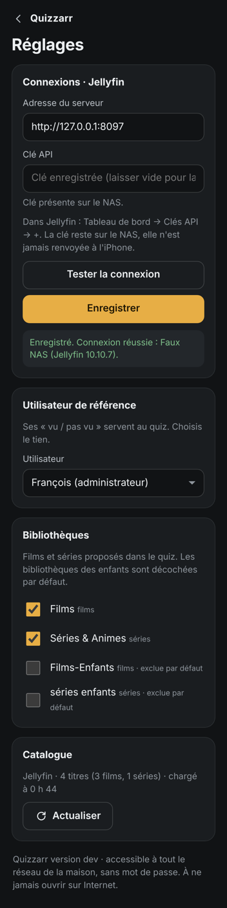

# Quizzarr

**Quoi regarder ce soir ?** Quizzarr pose au plus cinq questions à deux réponses (« Un film ou une série ? », « Léger ou intense ? »…) et réduit la bibliothèque Jellyfin à 3 à 5 titres, avec pour chacun une fiche récap et l'heure à laquelle on aura fini.

C'est une petite app web auto-hébergée, dans un seul conteneur Docker, à côté de Jellyfin (et plus tard de Radarr et Sonarr). Elle s'utilise sur iPhone et iPad, ajoutée à l'écran d'accueil, **sur le Wi-Fi de la maison uniquement**. Projet frère de [Calendarr](https://github.com/Frankless/calendarr).

| Accueil | Question | Résultats | Réglages |
|---|---|---|---|
|  |  |  |  |

Les captures viennent du mode démo (bibliothèque d'exemple) et d'un faux serveur Jellyfin de test, à 0 h 45 : d'où les heures de fin après minuit. Sur iPad, les deux réponses sont côte à côte : [capture](docs/ipad-question.png).

## Ce que fait Quizzarr

- **Accueil** : l'heure, le nombre de titres disponibles, un gros bouton « C'est parti ».
- **Questions** : cinq au plus, deux gros boutons, une barre de progression, un bouton retour. À chaque tour, Quizzarr choisit la question qui coupe la liste le plus près de 50/50. Une question dont une réponse ne laisserait aucun titre n'est jamais posée.
- **Résultats** : 3 à 5 fiches qu'on fait défiler du doigt. Jaquette, titre, année, classification, note, genres, résumé (« Lire la suite »), et :
  - film : la durée et « Fini à 22 h 47 si on lance maintenant » ;
  - série : « 12 épisodes restants · 8 h 40 pour la finir », « Prochain : S02E05 · fini à 22 h 10 », ou « Pas encore commencée ».
- **Lire** ouvre la page du titre dans Jellyfin. **Pas ce soir** écarte le titre jusqu'au lendemain matin (5 h), sur cet appareil.
- **Mode démo** : tant que Jellyfin n'est pas connecté, une bibliothèque d'exemple de 20 titres inventés permet d'essayer tout le quiz. Un bandeau « Mode démo » le signale ; il disparaît dès que Jellyfin est connecté.

Les questions de la V1 : film ou série ; court ou long (film de moins de 1 h 45, épisodes de moins de 40 min) ; léger ou intense (d'après les genres) ; déjà vu ou jamais vu ; récent (moins de 10 ans) ou plus ancien ; fini avant 23 h ou peu importe.

## Installation sur le NAS Ugreen (UGOS)

### Le fichier compose

Le même fichier est dans [`deploy/compose.yaml`](deploy/compose.yaml).

```yaml
services:
  quizzarr:
    image: ghcr.io/frankless/quizzarr:latest
    container_name: quizzarr
    restart: unless-stopped
    ports:
      - "7980:7980"
    environment:
      TZ: Europe/Brussels
    volumes:
      - /volume3/docker/quizzarr:/config
```

Aucune adresse ni clé dans ce fichier : elles se saisissent dans l'app. Le port 7979 reste à Calendarr, Quizzarr prend le 7980.

### Étapes

1. Dans UGOS, ouvrir **Fichiers** et créer le dossier `docker/quizzarr` sur le volume 3 (il deviendra `/volume3/docker/quizzarr`). C'est là que Quizzarr range ses réglages.
2. Ouvrir l'app **Docker**, aller dans **Projet**, puis **Créer**.
3. Nom du projet : `quizzarr`. **Dossier de stockage du projet** : choisir `/volume3/docker/quizzarr`.
4. Coller le fichier compose ci-dessus dans la zone prévue (remplacer ce qui s'y trouve).
5. Valider, puis **Démarrer** le projet. UGOS télécharge l'image (une minute environ) et lance le conteneur `quizzarr`.
6. Sur l'iPhone ou l'iPad, dans **Safari**, ouvrir `http://<adresse-du-NAS>:7980` (la même adresse que Calendarr, avec 7980 au lieu de 7979).
7. Toucher **Partager** (le carré avec la flèche), puis **Sur l'écran d'accueil**, puis **Ajouter**. Quizzarr s'ouvre ensuite en plein écran, comme une app. À refaire sur chaque iPhone et iPad.

Pour Uptime Kuma : une sonde HTTP sur `http://<adresse-du-NAS>:7980/health` (répond 200).

### Première configuration (Réglages)

Toucher l'icône des réglages en haut à droite.

1. **Connexions · Jellyfin** : l'adresse du serveur, par exemple `http://192.168.2.239:8096`, et une clé API (dans Jellyfin : Tableau de bord → Clés API → +, nommée par exemple « Quizzarr »). **Tester la connexion** répond clairement : connexion réussie, adresse injoignable, ou clé refusée. Puis **Enregistrer**.
2. **Utilisateur de référence** : choisir ton compte Jellyfin. Ses « vu / pas vu » et les épisodes en cours servent au quiz.
3. **Bibliothèques** : cocher celles à proposer. Par défaut, toutes les bibliothèques de films et de séries sont incluses (animes compris), sauf `films-enfants` et `series-enfants`.
4. **Actualiser** recharge le catalogue tout de suite. Sinon, Quizzarr le recharge tout seul au lancement d'un quiz quand il a plus de 10 minutes.

**Bouton Lire** : il ouvre `<adresse saisie>/web/index.html#!/details?id=…`, donc **l'adresse saisie dans Réglages** doit être joignable depuis l'iPhone (une adresse IP du réseau local, pas `localhost`).

## Sécurité, à lire

- **Pas de mot de passe** (choix de François) : toute personne sur le Wi-Fi de la maison peut ouvrir Quizzarr, **y compris la page Réglages** (changer l'adresse de Jellyfin, choisir l'utilisateur, cocher les bibliothèques des enfants).
- **Le port 7980 ne doit jamais être exposé hors de la maison** : pas de redirection de port sur la box, pas de reverse proxy public.
- La clé API est enregistrée dans `/config/connections.json` (droits 600, lisible seulement par l'utilisateur du conteneur). Elle n'est **jamais** renvoyée au navigateur (l'app affiche seulement « clé présente »), n'apparaît pas dans les journaux, et les jaquettes passent par Quizzarr (`/img/…`) pour que l'iPhone n'ait jamais besoin de la clé. Si l'adresse de Jellyfin change, l'ancienne clé est effacée et n'est pas envoyée au nouveau serveur.
- Quizzarr ne parle qu'à Jellyfin : pas de télémétrie, pas de police ni d'icône chargée depuis Internet.

## Ajuster les questions

- Les questions sont dans [`app/questions.py`](app/questions.py) (texte, réponses, seuils : 1 h 45, 40 min, 10 ans, 23 h).
- La table « léger / intense » est dans [`app/moods.json`](app/moods.json). Pour l'ajuster sans reconstruire l'image : la copier dans `/volume3/docker/quizzarr/moods.json`, la modifier, redémarrer le conteneur. Les genres sont comparés sans majuscules, accents ni tirets, en français comme en anglais.

## Mettre à jour

Chaque modification sur `main` publie une nouvelle image `ghcr.io/frankless/quizzarr:latest`. Dans UGOS : Docker → Projet → `quizzarr` → arrêter, puis reconstruire / redémarrer en retéléchargeant l'image. Les réglages, dans `/volume3/docker/quizzarr`, sont conservés.

## Retour arrière

- **Supprimer Quizzarr** : Docker → Projet → `quizzarr` → Arrêter, puis Supprimer. Le dossier de données `/volume3/docker/quizzarr` **n'est pas touché** : le supprimer à la main dans Fichiers si on veut tout effacer. Retirer l'icône de l'écran d'accueil de l'iPhone.
- **Revenir à une version précédente** : chaque publication a aussi une étiquette `sha-xxxxxxx` (visible dans l'onglet Packages du dépôt). Remplacer `latest` par cette étiquette dans le compose et redémarrer le projet.
- Quizzarr ne modifie rien dans Jellyfin (il ne fait que lire), ni dans Calendarr.

## Décisions et hypothèses

Prises pendant que François n'était pas là ; toutes modifiables.

1. **Dépôt** : la session de développement n'avait pas le droit de créer `Frankless/quizzarr`. Le code est livré dans le dossier `quizzarr/` du dépôt `Frankless/Test-The-World` (branche `claude/quizzarr-v1-0jev4b`), prêt à être poussé tel quel dans un nouveau dépôt `Frankless/quizzarr` (voir « Publier le dépôt » plus bas). Le workflow GitHub Actions ne se déclenche qu'une fois à la racine du nouveau dépôt.
2. **Stack reprise de Calendarr** (lu en lecture seule) : Python 3.12, FastAPI, httpx, interface HTML/CSS/JS sans framework ni étape de build, `/config` rendu à l'utilisateur 1000:1000 au démarrage puis abandon des droits root, même structure de `connections.json` (droits 600), même schéma de publication GitHub Actions (multi-architecture amd64/arm64).
3. **Publication** : contrairement à Calendarr (image `edge` sur `main`, `latest` aux versions), Quizzarr publie **`latest` à chaque push sur `main`**, comme demandé, plus une étiquette `sha-…` pour revenir en arrière. Les tests doivent passer avant la publication. Le paquet GHCR est privé par défaut à sa première publication : le passer en **public** dans GitHub → Packages → quizzarr → Package settings → Change visibility.
4. **Lien Lire** : format `…/web/index.html#!/details?id=…` comme demandé. Calendarr utilise `…/web/#/details?id=…` (format des Jellyfin récents) ; les deux fonctionnent normalement. Si le lien n'ouvre que l'accueil de Jellyfin, c'est une ligne à changer dans `app/cards.py`.
5. **Choix de la question** : on compte combien de titres chaque réponse garde, et on prend la question où les deux nombres sont les plus proches. Une question doit laisser au moins un titre des deux côtés **et** réduire la liste (une question où les deux réponses gardent tout n'est pas posée). À égalité, l'ordre du catalogue décide.
6. **Données manquantes** (pas de durée, pas d'année, genres ni légers ni intenses, ou autant de l'un que de l'autre) : le titre reste des deux côtés, comme demandé pour les genres.
7. **Léger / intense** : un point par genre léger, un point par genre intense ; le plus grand gagne. « Science-fiction » compte comme intense (impossible de savoir si elle est « sombre ») ; Action, Aventure et Fantastique sont neutres ; Documentaire est léger.
8. **« Fini avant 23 h »** : film = maintenant + ce qui reste du film (s'il est en cours) ; série = maintenant + ce qui reste du prochain épisode. Fini à 23 h 00 pile compte comme « avant ». Après 23 h et jusqu'à 5 h du matin, la question n'est plus posée. « Peu importe » garde tout.
9. **Séries** : saison 0 ignorée ; « déjà vu » = au moins un épisode vu ; un épisode commencé compte pour ce qu'il en reste ; s'il y en a plusieurs, le plus récemment regardé est le « prochain ». Une série entièrement vue affiche « Déjà vue en entier » et propose de revoir depuis S01E01. Une série sans aucun épisode (hors spéciaux) sur le disque est ignorée. La « durée d'un épisode » d'une série est la moyenne de ses épisodes.
10. **Tirage final** : s'il reste plus de 5 titres après 5 questions, 5 sont tirés au hasard, pondérés par la note (note sur 10 ; 6 si inconnue). Le tirage est fixé pour un même quiz : revenir en arrière puis en avant redonne les mêmes fiches. Les fiches sont affichées de la mieux notée à la moins bien notée.
11. **Pas ce soir** : jusqu'au lendemain 5 h (pas minuit, pour qu'un titre écarté à 23 h 30 ne revienne pas à minuit). Stocké sur l'appareil (pas partagé entre l'iPhone et l'iPad) ; une fiche écartée disparaît sans être remplacée.
12. **Bibliothèques** : seules les bibliothèques de films, de séries ou mixtes sont proposées (pas la musique, les livres ni la TV en direct). Une nouvelle bibliothèque est incluse automatiquement, sauf si son nom ressemble à « films-enfants » ou « series-enfants ».
13. **Pas de service worker** : l'icône sur l'écran d'accueil fonctionne sans, et rien n'est mis en cache côté iPhone (`Cache-Control: no-cache`), donc les données sont toujours fraîches. Les jaquettes sont gardées 10 minutes.
14. **Petite protection** : les requêtes qui modifient quelque chose doivent porter l'en-tête `X-Quizzarr`, pour qu'une page web malveillante ouverte sur le réseau ne puisse pas changer les réglages à ta place. Ce n'est pas une authentification.
15. **Thème** : sombre uniquement (pas de thème clair automatique), accent ambre, polices système de l'iPhone.

## Sous le capot

```
app/
  main.py         routes : page, API, /img (jaquettes), /health
  quiz.py         l'algorithme du quiz (fonctions pures, testées)
  questions.py    le catalogue de questions
  moods.json      la table léger / intense
  model.py        format commun d'un titre + calcul des épisodes restants
  cards.py        textes des fiches (durées, heures de fin)
  clock.py        heures en Europe/Brussels
  catalog.py      cache du catalogue (10 minutes)
  settings.py     /config/connections.json et /config/settings.json
  sources/        jellyfin.py, demo.py (Radarr et Sonarr viendront ici)
  static/         index.html, app.js, style.css, icônes, manifest
tests/            tests unitaires + test d'intégration contre un faux Jellyfin
deploy/           compose.yaml pour UGOS
```

Lancer les tests : `pip install -r requirements-dev.txt && python -m pytest`.
Essayer en local sans NAS : `CONFIG_DIR=./config uvicorn app.main:app --port 7980`, puis `python -m tests.fake_jellyfin 8097` pour un faux Jellyfin (adresse `http://127.0.0.1:8097`, clé `test-key`).

## Publier le dépôt

À faire une fois, par François :

1. Sur GitHub, créer le dépôt **`Frankless/quizzarr`** (public, sans README).
2. Copier le contenu du dossier `quizzarr/` à la racine de ce nouveau dépôt (y compris le dossier caché `.github`), puis pousser sur `main`.
3. Attendre la fin de l'action « Image Docker » (onglet Actions), puis rendre le paquet public (décision 3).
