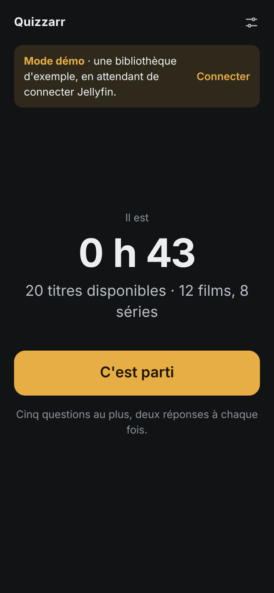
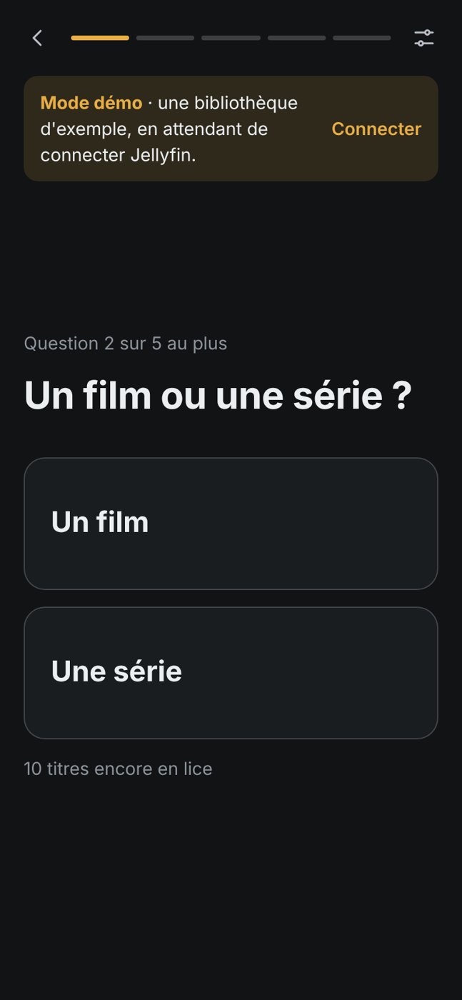
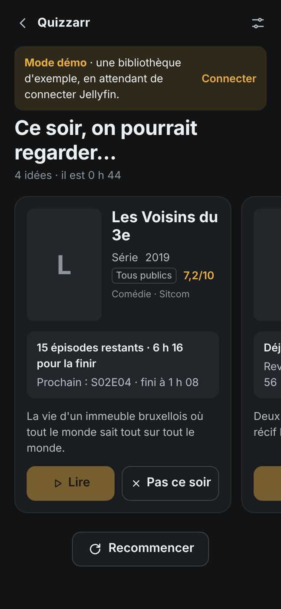

# Quizzarr

**What should we watch tonight?** Quizzarr asks at most five two-choice questions ("A movie or a series?", "Light or intense?"…) and narrows the Jellyfin library down to 3–5 titles, each with a summary card and the time you would finish if you pressed Play now.

It is a small self-hosted web app, in a single Docker container, next to Jellyfin (and later Radarr and Sonarr). It is used on iPhone and iPad, added to the home screen, **on the home Wi-Fi only**. Sister project of [Calendarr](https://github.com/Frankless/calendarr).

The app itself is in French (Belgium); button and screen names below are quoted as they appear in the app.

| Home | Question | Results | Settings |
|---|---|---|---|
|  |  |  |  |

Screenshots come from demo mode (sample library) and from a fake Jellyfin test server, taken at 0:45 a.m., hence the end times after midnight. On iPad the two answers sit side by side: [screenshot](docs/ipad-question.png).

## What Quizzarr does

- **Home** («Accueil»): the current time, the number of available titles, a big «C'est parti» button.
- **Questions**: five at most, two big buttons, a progress bar, a back button. At each step Quizzarr picks the question that splits the remaining list closest to 50/50. A question where one answer would leave no title is never asked.
- **Results**: 3–5 cards you swipe through. Poster, title, year, age rating, community rating, genres, overview («Lire la suite» to expand), plus:
  - movie: running time and «Fini à 22 h 47 si on lance maintenant» (done at 22:47 if we start now);
  - series: «12 épisodes restants · 8 h 40 pour la finir» (episodes and time left), «Prochain : S02E05 · fini à 22 h 10» (next episode and its end time), or «Pas encore commencée» (not started yet).
- **«Lire»** (Play) opens the title's page in Jellyfin. **«Pas ce soir»** (not tonight) hides the title until 5 a.m. the next morning, on that device.
- **Demo mode**: as long as Jellyfin is not connected, a sample library of 20 made-up titles lets you try the whole quiz. A «Mode démo» banner says so; it disappears as soon as Jellyfin is connected.

V1 questions: movie or series; short or long (movie under 1 h 45, episodes under 40 min); light or intense (from the genres); already seen or never seen; recent (under 10 years) or older; finished before 11 p.m. or doesn't matter.

## Installing on the Ugreen NAS (UGOS)

### The compose file

The same file is in [`deploy/compose.yaml`](deploy/compose.yaml).

```yaml
services:
  quizzarr:
    image: ghcr.io/frankless/quizzarr:latest
    container_name: quizzarr
    restart: unless-stopped
    ports:
      - "7980:7980"
    environment:
      TZ: Europe/Brussels
    volumes:
      - /volume3/docker/quizzarr:/config
```

No address or key in this file: they are entered in the app. Port 7979 stays with Calendarr; Quizzarr uses 7980.

### Steps

1. In UGOS, open **Files** and create the folder `docker/quizzarr` on volume 3 (it becomes `/volume3/docker/quizzarr`). Quizzarr keeps its settings there.
2. Open the **Docker** app, go to **Project**, then **Create**.
3. Project name: `quizzarr`. **Project storage folder**: pick `/volume3/docker/quizzarr`.
4. Paste the compose file above into the editor (replacing whatever is there).
5. Confirm, then **Start** the project. UGOS downloads the image (about a minute) and starts the `quizzarr` container.
6. On the iPhone or iPad, in **Safari**, open `http://<NAS-address>:7980` (same address as Calendarr, with 7980 instead of 7979).
7. Tap **Share** (the square with the arrow), then **Add to Home Screen**, then **Add**. Quizzarr then opens full screen, like an app. Repeat on each iPhone and iPad.

For Uptime Kuma: an HTTP monitor on `http://<NAS-address>:7980/health` (returns 200).

### First-time setup («Réglages»)

Tap the settings icon in the top right corner.

1. **«Connexions · Jellyfin»**: the server address, for example `http://192.168.2.239:8096`, and an API key (in Jellyfin: Dashboard → API Keys → +, named e.g. "Quizzarr"). **«Tester la connexion»** (test connection) gives a clear answer: connected, address unreachable, or key rejected. Then **«Enregistrer»** (save).
2. **«Utilisateur de référence»** (reference user): pick your own Jellyfin account. Its watched / unwatched state and episodes in progress drive the quiz.
3. **«Bibliothèques»** (libraries): tick the ones to include. By default every movie and series library is included (anime included), except `films-enfants` and `series-enfants`.
4. **«Actualiser»** (refresh) reloads the catalogue right away. Otherwise Quizzarr reloads it by itself when a quiz starts and the copy is older than 10 minutes.

**Play button**: it opens `<address entered>/web/index.html#!/details?id=…`, so **the address entered in Settings** must be reachable from the iPhone (a local network IP address, not `localhost`).

## Security, please read

- **No password** (François's decision): anyone on the home Wi-Fi can open Quizzarr, **including the Settings page** (change the Jellyfin address, pick the user, tick the children's libraries).
- **Port 7980 must never be exposed outside the home**: no port forwarding on the router, no public reverse proxy.
- The API key is stored in `/config/connections.json` (mode 600, readable only by the container user). It is **never** sent back to the browser (the app only shows "key present"), never written to the logs, and posters go through Quizzarr (`/img/…`) so the iPhone never needs the key. If the Jellyfin address changes, the old key is erased and never sent to the new server.
- Quizzarr only talks to Jellyfin: no telemetry, no font or icon loaded from the Internet.

## Tuning the questions

- Questions live in [`app/questions.py`](app/questions.py) (text, answers, thresholds: 1 h 45, 40 min, 10 years, 11 p.m.).
- The light / intense table is in [`app/moods.json`](app/moods.json). To adjust it without rebuilding the image: copy it to `/volume3/docker/quizzarr/moods.json`, edit it, restart the container. Genres are compared ignoring case, accents and dashes, in French and in English.

## Updating

Every change on `main` publishes a new `ghcr.io/frankless/quizzarr:latest` image. In UGOS: Docker → Project → `quizzarr` → stop, then rebuild / restart pulling the image again. Settings, in `/volume3/docker/quizzarr`, are kept.

## Rolling back

- **Remove Quizzarr**: Docker → Project → `quizzarr` → Stop, then Delete. The data folder `/volume3/docker/quizzarr` is **not touched**: delete it by hand in Files to wipe everything. Remove the icon from the iPhone home screen.
- **Go back to a previous version**: every publish also gets a `sha-xxxxxxx` tag (visible under the repository's Packages). Replace `latest` with that tag in the compose file and restart the project.
- Quizzarr changes nothing in Jellyfin (read-only) and nothing in Calendarr.

## Decisions and assumptions

Made while François was away; all can be changed.

1. **Repository**: `Frankless/quizzarr`, branch `main`. The code was first written in a folder of the `Test-The-World` repository (the development session could not create a repository), then pushed here with its history.
2. **Stack taken from Calendarr** (read only): Python 3.12, FastAPI, httpx, HTML/CSS/JS front end with no framework and no build step, `/config` handed to user 1000:1000 at start-up before dropping root, same `connections.json` layout (mode 600), same GitHub Actions publishing pattern (multi-arch amd64/arm64).
3. **Publishing**: unlike Calendarr (`edge` image on `main`, `latest` on releases), Quizzarr publishes **`latest` on every push to `main`**, as requested, plus a `sha-…` tag for rolling back. Tests must pass before publishing. The GHCR package is private on first publish: make it **public** under GitHub → Packages → quizzarr → Package settings → Change visibility.
4. **Play link**: `…/web/index.html#!/details?id=…` format, as requested. Calendarr uses `…/web/#/details?id=…` (format of recent Jellyfin versions); both should work. If the link only opens Jellyfin's home page, it is a one-line change in `app/cards.py`.
5. **Picking the question**: count how many titles each answer keeps, and pick the question where both numbers are closest. A question must leave at least one title on each side **and** narrow the list (a question where both answers keep everything is not asked). Ties follow the catalogue order.
6. **Missing data** (no running time, no year, genres neither light nor intense, or as many of each): the title stays on both sides, as requested for genres.
7. **Light / intense**: one point per light genre, one per intense genre; the higher score wins. Science fiction counts as intense (there is no way to tell whether it is "dark"); Action, Adventure and Fantasy are neutral; Documentary is light.
8. **"Finished before 11 p.m."**: movie = now + what is left of it (if in progress); series = now + what is left of the next episode. Ending at exactly 23:00 counts as "before". From 11 p.m. to 5 a.m. the question is no longer asked. "Doesn't matter" keeps everything.
9. **Series**: season 0 ignored; "seen" = at least one episode watched; an episode in progress counts for what is left of it; if several are in progress, the most recently watched one is "next". A fully watched series shows «Déjà vue en entier» and offers a rewatch from S01E01. A series with no (non-special) episode on disk is ignored. A series' "episode length" is the average of its episodes.
10. **Final draw**: if more than 5 titles remain after 5 questions, 5 are drawn at random, weighted by rating (out of 10; 6 when unknown). The draw is fixed for a given quiz: going back and forth gives the same cards. Cards are sorted best rated first.
11. **Not tonight**: until 5 a.m. the next day (not midnight, so a title hidden at 23:30 does not come back at midnight). Stored on the device (not shared between iPhone and iPad); a hidden card disappears without being replaced.
12. **Libraries**: only movie, series or mixed libraries are offered (no music, books or live TV). A new library is included automatically, unless its name looks like "films-enfants" or "series-enfants".
13. **No service worker**: the home-screen icon works without one, and nothing is cached on the iPhone (`Cache-Control: no-cache`), so data is always fresh. Posters are kept for 10 minutes.
14. **Light protection**: requests that change something must carry the `X-Quizzarr` header, so that a malicious web page opened on the network cannot change settings behind your back. This is not authentication.
15. **Theme**: dark only (no automatic light theme), amber accent, iPhone system fonts.

## Under the hood

```
app/
  main.py         routes: page, API, /img (posters), /health
  quiz.py         the quiz algorithm (pure, tested functions)
  questions.py    the question catalogue
  moods.json      the light / intense table
  model.py        common title format + remaining episodes maths
  cards.py        card texts (durations, end times)
  clock.py        times in Europe/Brussels
  catalog.py      catalogue cache (10 minutes)
  settings.py     /config/connections.json and /config/settings.json
  sources/        jellyfin.py, demo.py (Radarr and Sonarr will go here)
  static/         index.html, app.js, style.css, icons, manifest
tests/            unit tests + integration test against a fake Jellyfin
deploy/           compose.yaml for UGOS
```

Run the tests: `pip install -r requirements-dev.txt && python -m pytest`.
Try it locally without the NAS: `CONFIG_DIR=./config uvicorn app.main:app --port 7980`, then `python -m tests.fake_jellyfin 8097` for a fake Jellyfin (address `http://127.0.0.1:8097`, key `test-key`).

## After the first publish

The `ghcr.io/frankless/quizzarr` package is private by default: GitHub → profile → Packages → quizzarr → Package settings → Change visibility → Public. Without this, UGOS cannot download the image.
